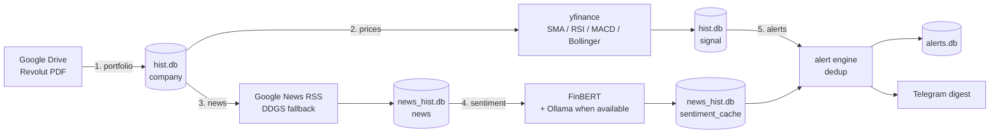

# CrappyFinAssist

As it's already stated, this is just a crappy financial assistant — but it's a complete one.

It reads your **Revolut stock portfolio**, watches every position with **technical indicators** and **news sentiment**, and sends you a **Telegram digest** whenever something changes: which signals just triggered, what the news is saying (with an AI-written summary and every source linked), and a snapshot of the numbers. It runs by itself from cron on a home Linux box, with an optional local LLM (Ollama) doing the harder reading.

> **Not investment advice.** The output is quantitative alerts and summaries of public news. The AI summaries are explicitly instructed not to recommend buying or selling.

---

## Table of contents

1. [How it works](#how-it-works)
2. [What a digest looks like](#what-a-digest-looks-like)
3. [Requirements](#requirements)
4. [Setup](#setup)
   1. [Python environment and packages](#1-python-environment-and-packages)
   2. [Playwright browser](#2-playwright-browser)
   3. [Databases](#3-databases)
   4. [Google Drive (OAuth) — portfolio statements](#4-google-drive-oauth--portfolio-statements)
   5. [Telegram bot — notifications](#5-telegram-bot--notifications)
   6. [FinBERT model](#6-finbert-model)
   7. [Ollama — optional LLM](#7-ollama--optional-llm)
   8. [First run](#8-first-run)
   9. [Scheduling with cron](#9-scheduling-with-cron)
5. [Running it](#running-it)
6. [Configuration](#configuration)
7. [How each phase works](#how-each-phase-works)
8. [Data and files](#data-and-files)
9. [Operations: logs, stopping, safety](#operations-logs-stopping-safety)
10. [Troubleshooting](#troubleshooting)
11. [Known limitations](#known-limitations)

---

## How it works

Five phases, run in order by `pipeline.py`:



| # | Phase | Module | What it does |
|---|-------|--------|--------------|
| 1 | Portfolio | `pdf_from_drive.py`, `pdf_extract.py`, `db_man.py` | Downloads the newest Revolut statement PDF from a Drive folder, parses the EUR and USD portfolio tables, updates your holdings and removes positions you've sold. |
| 2 | Prices & technicals | `price_data.py` | Pulls a year of daily prices from yfinance and computes 11 technical signals per holding. |
| 3 | News discovery | `sentiment_digest.py` | Finds recent articles about each holding (Google News RSS, falling back to DuckDuckGo site-restricted search). |
| 4 | Sentiment | `sentiment_digest.py` | Classifies each new article positive / neutral / negative. FinBERT does the fast pass; articles FinBERT is likely to get wrong are escalated to a local LLM. Results are cached, so each article is classified once. |
| 5 | Alerts & delivery | `alert_engine.py`, `send_mes.py` | Fires an alert when a signal or the overall news sentiment *changes*, and sends a per-ticker Telegram digest. |

Each phase is isolated: if one fails (Drive login expired, yfinance down…), the others still run on the data they have, and you get a Telegram warning.

---

## What a digest looks like

One Telegram message per run that produced alerts, with a section per affected ticker:

```
CrappyFinAssist - 3 new alert(s) across 2 ticker(s)

MU · Micron Technology
Price 1055.25 · RSI 58.55 · SMA20-SMA200 +335.27 · MACD hist +8.95

📈 Technical
🟢 MACD is above its signal line

📰 News sentiment: 3 positive · 2 neutral · 0 negative
🟢 sentiment just turned bullish

🤖 Recent coverage highlights AI as Micron's main growth driver, with Baird
   predicting agentic AI will push the company higher ... (3-5 sentences,
   grounded only in the articles, no buy/sell advice)

Sources
🟢 Agentic AI will drive Micron to new heights, says Baird - CNBC
🟢 Micron Earnings: What to Expect as AI Demand Drives Growth - Yahoo Finance
⚪ Clay supervisor race: With Micron coming, should top job be full-time? ...
━━━━━━━━━━
...
```

Every source is a clickable link tagged with its own classification. If nothing changed in a run, no message is sent.

---

## Requirements

- **Linux** with `cron`, `flock` and `timeout` (developed on Fedora 44). The pipeline uses `fcntl`, so it won't run on Windows as-is.
- **Python 3.14** is what it's tested on; 3.10+ should work (the code uses `match` and `X | None` types).
- A **Revolut** account that produces a PDF statement with *"EUR Portfolio breakdown"* / *"USD Portfolio breakdown"* tables.
- A **Google account** (Drive holds the statements).
- A **Telegram** account.
- Optional: a machine running **Ollama** (can be the same box or another one on your LAN). Without it, everything still works on FinBERT alone, minus the AI summaries.
- ~3 GB disk for PyTorch, the FinBERT model and the Playwright browser.

---

## Setup

All commands are run from the project folder:

```bash
cd /home/user/ai_harness
```

### 1. Python environment and packages

```bash
python3 -m venv venv
./venv/bin/pip install --upgrade pip

./venv/bin/pip install \
    requests pandas numpy yfinance pdfplumber \
    google-api-python-client google-auth google-auth-oauthlib google-auth-httplib2 \
    ddgs pygooglenews feedparser beautifulsoup4 dateparser \
    trafilatura playwright \
    torch transformers huggingface_hub
```

Versions this project is tested with:

| Package | Version | Package | Version |
|---|---|---|---|
| requests | 2.34.2 | ddgs | 9.16.0 |
| pandas | 3.0.5 | pygooglenews | 0.1.3 |
| numpy | 2.5.3 | feedparser | 6.0.14 |
| yfinance | 1.7.0 | trafilatura | 2.2.0 |
| pdfplumber | 0.11.10 | playwright | 1.62.0 |
| google-api-python-client | 2.200.0 | torch | 2.14.0 |
| google-auth | 2.58.0 | transformers | 5.17.0 |
| google-auth-oauthlib | 1.4.1 | huggingface_hub | 1.31.0 |

`gnews` is **not** a pip package here — `gnews.py` is a local module in this repo (it decodes Google News redirect links into real publisher URLs). Don't `pip install gnews`; it would shadow nothing but add confusion.

If `pygooglenews` fails to resolve its dependencies (it historically pinned an old feedparser), install it without them and add them yourself:

```bash
./venv/bin/pip install --no-deps pygooglenews
./venv/bin/pip install feedparser beautifulsoup4 dateparser
./venv/bin/pip check     # should print "No broken requirements found."
```

On a CPU-only machine you can save a lot of disk with the CPU build of PyTorch:

```bash
./venv/bin/pip install torch --index-url https://download.pytorch.org/whl/cpu
```

### 2. Playwright browser

Article pages are fetched with a real Chromium (many news sites need JavaScript and a consent click):

```bash
./venv/bin/playwright install chromium
```

`playwright install-deps` only works on Debian/Ubuntu. On Fedora, if Chromium fails to launch with a missing-library error, install the library it names with `dnf`.

### 3. Databases

Everything lives in `data/`. The portfolio database needs its tables created once; the other two databases create their own tables automatically.

```bash
mkdir -p data
./venv/bin/python3 -c "import db_man; db_man.init()"
```

This creates `data/hist.db` with the `company`, `signal` and `history` tables.

The prompt files `data/prompt.txt`, `data/opinion_prompt.txt` and `data/digest_prompt.txt` are part of the repo — keep them in `data/`.

### 4. Google Drive (OAuth) — portfolio statements

The pipeline reads the **most recently modified file** in one Drive folder, so the workflow is: export your statement from Revolut as PDF → drop it into that folder.

#### a. Create the Google Cloud credentials

1. Go to <https://console.cloud.google.com/> and create a project (any name).
2. **APIs & Services → Library** → search **Google Drive API** → **Enable**.
3. **Google Auth Platform → Branding / Audience** (older UI: *OAuth consent screen*):
   - User type: **External**.
   - Fill in the app name and your email.
   - Under **Test users**, add your own Google account.
4. **Google Auth Platform → Clients** (older UI: *Credentials → Create credentials → OAuth client ID*):
   - Application type: **Desktop app**.
   - Create, then **Download JSON**.
5. Save that file in the project folder as **`credentials.json`**.

#### b. Publish the app — or your login dies every 7 days

While the app's publishing status is **Testing**, Google revokes its refresh tokens after 7 days, and the portfolio stage starts failing with `invalid_grant: Token has been expired or revoked`. In **Google Auth Platform → Audience**, click **Publish app** to move it to **In production**. For personal use you don't need Google's verification — you'll just see an "unverified app" warning once when you log in (click *Advanced → Go to …*).

#### c. Point it at your folder

Open the Drive folder in a browser; the URL looks like `https://drive.google.com/drive/folders/1sl53d_l_k9zZHn2YV_vvTanfMAYNqNdL`. Put the last part into `FOLDER_ID` at the top of `pdf_from_drive.py`.

#### d. Log in once, interactively

```bash
./venv/bin/python3 pdf_from_drive.py
```

A browser opens; log in and approve. This writes **`token.json`**, which is refreshed automatically from then on, and downloads the newest statement to `stats.pdf`.

This step **must** be done by hand: cron can't open a browser, so if `token.json` is missing or unusable the pipeline skips the portfolio stage (and tells you) rather than hang waiting for a login. If you ever change `SCOPES` in `pdf_from_drive.py`, delete `token.json` and log in again.

`credentials.json`, `token.json` and `*.pdf` are gitignored — never commit them.

### 5. Telegram bot — notifications

1. In Telegram, open **[@BotFather](https://t.me/BotFather)**, send `/newbot`, choose a name and a username ending in `bot`. BotFather replies with a token like `123456789:AA...`.
2. Create **`secrets.env`** in the project folder:

   ```
   TELEGRAM_BOT_TOKEN=123456789:AA...
   TELEGRAM_CHAT_ID=
   ```

3. Open your new bot in Telegram, press **Start** and send it any message.
4. Find your chat id:

   ```bash
   ./venv/bin/python3 send_mes.py --chat-id
   ```

   Copy the printed `chat_id` into `secrets.env` as `TELEGRAM_CHAT_ID=...`. (Only works for about 24 h after you messaged the bot — if it says "No updates found", message the bot again.)
5. Test it:

   ```bash
   ./venv/bin/python3 send_mes.py --test
   ```

   You should receive "✅ CrappyFinAssist is wired up."

`secrets.env` is gitignored (`*.env`). Real environment variables with the same names override the file.

### 6. FinBERT model

Sentiment uses [`ahmedrachid/FinancialBERT-Sentiment-Analysis`](https://huggingface.co/ahmedrachid/FinancialBERT-Sentiment-Analysis) (~440 MB). Download it once, before scheduling — the cron job runs with `HF_HUB_OFFLINE=1` so a Hugging Face outage can't break a run, which means the model must already be cached:

```bash
./venv/bin/python3 -c "from transformers import pipeline; \
pipeline('sentiment-analysis', model='ahmedrachid/FinancialBERT-Sentiment-Analysis')"
```

It's stored under `~/.cache/huggingface/`.

### 7. Ollama — optional LLM

With Ollama available, the pipeline runs in **hybrid** mode: articles FinBERT is likely to misjudge are re-read by an LLM, and each ticker in the digest gets an AI summary. Without it, the pipeline detects that at startup and uses FinBERT only.

On the machine that will run the model:

```bash
curl -fsSL https://ollama.com/install.sh | sh
ollama pull qwen3.5:4b
```

If Ollama runs on **another machine** (as in the default config, `192.168.88.241`), it must listen on the network, not just localhost:

```bash
sudo systemctl edit ollama
# add:
#   [Service]
#   Environment="OLLAMA_HOST=0.0.0.0"
sudo systemctl restart ollama
```

…and port **11434** must be open in that machine's firewall (on Windows hosts, allow it in Windows Defender Firewall). Then set the address in `sentiment_digest.py`:

```python
DEF_MODEL = "qwen3.5:4b"
DEF_ENDPOINT = "http://<ollama-host>:11434/api/chat"
```

Check it from the pipeline machine:

```bash
curl http://<ollama-host>:11434/api/tags      # should list qwen3.5:4b
```

`qwen3.5:4b` is a reasoning model; all calls send `"think": false`, otherwise it can spend its whole output budget "thinking" and return an empty answer.

### 8. First run

Run the full pipeline once by hand, in the same bare environment cron uses, **without sending anything**:

```bash
env -i HOME="$HOME" PATH=/usr/bin:/bin ./venv/bin/python3 pipeline.py --no-send
tail -n 40 logs/pipeline.log
```

The end of the log shows a stage summary:

```
portfolio  ok     1.9s
prices     ok     1.9s
news       ok    43.4s
sentiment  ok     9.5s
alerts     ok     0.3s
total 61.4s
```

With `--no-send`, the digest is printed to the log instead of sent; any alerts it fired stay queued and go out with the next real run.

### 9. Scheduling with cron

`final_cron_job` contains the ready-made entries (weekdays at **08:00** and **23:30**, system timezone). Install them — this *appends*, keeping anything already in your crontab:

```bash
(crontab -l 2>/dev/null; cat /home/user/ai_harness/final_cron_job) | crontab -
crontab -l
```

If the project lives somewhere other than `/home/user/ai_harness`, edit the paths in `final_cron_job` first.

**Why those times:** both are outside Frankfurt and US trading hours, so yfinance's daily bars are complete. Because alerts fire on *changes*, running mid-session would let a signal flicker on and off with the live price and alert, clear, and alert again. 08:00 picks up overnight news before the markets open; 23:30 comes after both closes.

**Test that cron really runs it:** add a temporary line with the same command, scheduled two minutes from now, plus `--no-send`:

```bash
M=$(date -d '+2 min' +%-M); H=$(date -d '+2 min' +%-H)
(crontab -l; echo "$M $H * * * cd /home/user/ai_harness && mkdir -p logs && CFA_CRON_TEST=1 HARNESS_HEADLESS=1 HF_HUB_OFFLINE=1 timeout --kill-after=5m 2h ./venv/bin/python3 pipeline.py --no-send >> logs/cron.log 2>&1") | crontab -
# wait, then check:
grep "pipeline start" logs/pipeline.log | tail -1     # should show headless=True | send=False
# remove the test line:
crontab -l | grep -v CFA_CRON_TEST | crontab -
```

---

## Running it

| Command | What it does |
|---|---|
| `./venv/bin/python3 pipeline.py` | Full run, all 5 phases, sends the digest. **This is what cron runs.** |
| `./venv/bin/python3 pipeline.py --no-send` | Full run, prints the digest to the log instead; alerts stay queued. |
| `./venv/bin/python3 send_mes.py --run [--hybrid] [--no-ai]` | Phases 4–5 only: classify cached articles, fire alerts, deliver. |
| `./venv/bin/python3 send_mes.py --preview [--hybrid] [--no-ai]` | Re-render the last alert batch; sends nothing and changes nothing. |
| `./venv/bin/python3 send_mes.py --test` | Send a test message. |
| `./venv/bin/python3 send_mes.py --chat-id` | Show the chat ids that have messaged the bot. |
| `./venv/bin/python3 alert_engine.py` | Fire alerts without delivering (they queue for the next send). |

Running the phases one by one, e.g. to debug one of them (same order as the pipeline):

```bash
PY=./venv/bin/python3
$PY pdf_from_drive.py                          # 1. download newest statement -> stats.pdf
$PY pdf_extract.py                             # 1. parse it, update holdings, remove sold ones
$PY price_data.py                              # 2. prices -> technical signals
$PY -c "from sentiment_digest import discover_news_for_tickers as d; d(backend='google')"   # 3. news
$PY send_mes.py --run --hybrid                 # 4 + 5. classify, alert, deliver
```

Doing it this way skips the pipeline's safeguards (run lock, stage isolation, the Drive-login guard), which is why cron always calls `pipeline.py`.

`--hybrid` on `send_mes.py` is manual; `pipeline.py` decides hybrid vs FinBERT by itself by checking that Ollama is reachable *and* has the model pulled.

---

## Configuration

There's no config file; the knobs are constants at the top of each module.

| Setting | Where | Default | Meaning |
|---|---|---|---|
| `FOLDER_ID` | `pdf_from_drive.py` | — | Drive folder holding the Revolut PDFs. |
| `SCOPES` | `pdf_from_drive.py` | Drive scopes | Delete `token.json` after changing. |
| `DEF_MAP` | `price_data.py` | `TOTB→TOTB.F`, `AEU→AEU.F`, `VUAA→VUAA.DE` | Revolut ticker → yfinance symbol. **Every non-US holding needs an entry** (exchange suffix), or its prices won't load. US tickers need none. |
| `blacklist` | `sentiment_digest.py` | `"VUAA"` | Ticker excluded from news/sentiment/alerts (an ETF has no company news). |
| `TRUSTED_SOURCES` | `sentiment_digest.py` | Reuters, Bloomberg, WSJ, CNBC, AP, Yahoo Finance, Fortune, Business Insider, Economist, Google News | Domains searched by the DDGS backend and flagged "trusted". |
| `DEF_MAX_AGE_HOURS` | `sentiment_digest.py` | `48` | Only articles newer than this are discovered / summarized. |
| `DEF_MAX_RESULTS` | `sentiment_digest.py` | `5` | Articles per ticker. |
| `DEF_MODEL`, `DEF_ENDPOINT` | `sentiment_digest.py` | `qwen3.5:4b`, `http://192.168.88.241:11434/api/chat` | Ollama model and address. |
| `DEF_TEMPERATURE` | `sentiment_digest.py` | `0.1` | LLM temperature (low = consistent classifications). |
| `DEF_TIMEOUT` | `sentiment_digest.py` | `(10, 180)` | Ollama (connect, read) timeout in seconds. |
| `DDGS_*_DELAY`, `DDGS_MAX_RETRIES` | `sentiment_digest.py` | 0.5–1.5 s, 2 | Pacing/backoff so DuckDuckGo doesn't rate-limit you. |
| `REDIRECT_MAX_WAIT` | `sentiment_digest.py` | `15` s | How long a page may keep redirecting before it's given up on. |
| `SENTIMENT_ALERT_MIN_ARTICLES` | `alert_engine.py` | `3` | Minimum articles before sentiment can fire an alert. |
| Prompts | `data/prompt.txt`, `data/opinion_prompt.txt`, `data/digest_prompt.txt` | — | LLM classification, escalation opinion, and digest summary prompts. `{company_name}` is filled in; literal braces must be doubled (`{{ }}`). |
| Schedule | `final_cron_job` | Mon–Fri 08:00, 23:30 | Cron times (system timezone). |
| `HARNESS_HEADLESS` | env var | unset | `1` = headless browser. Set by cron; the pipeline also forces it when there's no display. |

---

## How each phase works

### 1. Portfolio

`pdf_from_drive.get_latest_stat()` downloads the newest file in `FOLDER_ID` to `stats.pdf`. `pdf_extract.import_statement()` then:

1. Finds the *"EUR Portfolio breakdown"* and *"USD Portfolio breakdown"* tables with pdfplumber and writes `EUR_output.csv` / `USD_output.csv`.
2. Upserts each holding (ticker, name, shares, average buy price, currency) into `company`.
3. **Removes sold positions**: any holding of a parsed currency that isn't in the new statement is deleted from `company`, together with its `signal` rows.

Pruning is deliberately conservative: it only touches currencies whose table was actually parsed this time, so a table that fails to parse can never wipe that currency's holdings. The pipeline also remembers the hash of the last successfully imported statement and skips re-parsing an unchanged one.

### 2. Prices & technical signals

`price_data.py` fetches one year of daily candles per holding from yfinance and evaluates:

| Signal | Triggers when |
|---|---|
| `golden_cross` / `death_cross` | 20-day SMA crosses above / below the 200-day SMA |
| `rsi_oversold` / `rsi_overbought` | RSI(14) below 30 / above 70 |
| `macd_bullish` / `macd_bearish` | MACD above / below its signal line |
| `macd_crossover_bull` / `macd_crossover_bear` | MACD line crosses above / below zero |
| `boll_lower_band` / `boll_upper_band` | Close below / above the 20-day Bollinger bands (±2σ) |
| `squeeze` | Bollinger bandwidth in the bottom 10% of the past year |

Results go to the `signal` table (one row per ticker × signal, overwritten each run). The pipeline checks that fresh rows were actually written, so a silent yfinance outage is reported instead of alerting on stale data.

### 3. News discovery

For each holding (company name, not ticker, is searched):

- **Google News RSS** (default): broad coverage; `gnews.py` decodes Google's redirect links into real publisher URLs.
- **DDGS** (fallback): one `site:` search per trusted domain, keeping only hits that are really on that domain and whose title mentions the company, with pacing and retry-on-rate-limit.

Only articles from the last `DEF_MAX_AGE_HOURS` are kept, and each (url, ticker) is stored once in `news`.

### 4. Sentiment

Each article page is opened in Chromium. Per-site scrapers click through cookie-consent dialogs (Yahoo, CNBC, Barron's/Business Insider, FT, Google, MarketScreener, NaturalGasIntel), and trafilatura extracts the text. If the result is a bot-check page, a consent notice, or too short, the article is judged from the headline in its URL instead.

Three classification methods exist:

| Method | How | Speed |
|---|---|---|
| `finbert` | FinancialBERT on the article text | ~seconds |
| `llm` | Ollama returns a JSON verdict (`data/prompt.txt`) | ~30–100 s |
| `hybrid` (default when Ollama is up) | FinBERT first; **escalate** to the LLM only when the article doesn't look market-relevant, or when FinBERT's per-paragraph verdicts disagree with its whole-article verdict. The LLM writes a plain-language opinion (`data/opinion_prompt.txt`), and FinBERT turns that opinion into the final label. | fast for most, slow for the few that need it |

Hybrid exists because FinBERT is fast but misreads mixed narratives (a negative story with a positive aside) and big-number stories that aren't really market news. Routing only those cases to the LLM keeps runs fast while fixing the worst misses. Prompts always name the company, so a story about Schwab winning clients *from* Ameriprise is judged from Schwab's side.

Every result is stored in `sentiment_cache`, keyed by (url, ticker, method), so each article is classified once per method. If Ollama drops out mid-run, affected articles keep their FinBERT verdict and aren't cached as hybrid, so they're retried next run.

### 5. Alerts & delivery

`alert_engine.py` fires an alert when:

- a technical signal **turns on**, or
- news sentiment for a ticker **turns** bullish or bearish — "overwhelming" means one side outnumbers the other two combined, with at least `SENTIMENT_ALERT_MIN_ARTICLES` articles. A flip from bearish to bullish fires again.

It fires on **transitions only**: a signal that stays on is silent on later runs; if it clears and triggers again, it fires again. State is kept in `data/alerts.db` (`alert_state`), and every alert is logged in `alert_log`.

`send_mes.py` groups the alerts into one digest (snapshot, plain-language signals, sentiment tally, AI summary, tagged sources) and sends it. Delivery is **at-least-once**: alerts are only marked delivered after Telegram confirms, so a failed send is retried on the next run (a multi-part digest that fails halfway may therefore repeat the parts that did arrive).

---

## Data and files

### Databases (`data/`)

| File | Tables | Contents |
|---|---|---|
| `hist.db` | `company`, `signal`, `history` | Holdings, current technical signals, a history log table. Created by `db_man.init()`. |
| `news_hist.db` | `news`, `sentiment_cache` | Discovered articles; classification results per article and method. Auto-created. |
| `alerts.db` | `alert_state`, `alert_log` | Last known state per ticker × alert (for dedup); every fired alert with its delivery status. Auto-created. |

Useful resets:

```bash
# re-classify one site's articles from scratch (e.g. after fixing its scraper)
./venv/bin/python3 -c "import sqlite3; c=sqlite3.connect('data/news_hist.db'); \
c.execute(\"DELETE FROM sentiment_cache WHERE url LIKE '%cnbc.com%'\"); c.commit()"

# see what's still waiting to be delivered
./venv/bin/python3 -c "import alert_engine; print(alert_engine.pending_alerts())"
```

### Project layout

| File | Purpose |
|---|---|
| `pipeline.py` | Orchestrator — runs all phases; what cron calls. |
| `final_cron_job` | Crontab entries, with install / remove instructions. |
| `pdf_from_drive.py` | Phase 1: Drive OAuth + download newest statement. |
| `pdf_extract.py` | Phase 1: PDF tables → CSV → `company` table (`import_statement`). |
| `db_man.py` | SQLite helpers: `init`, `upsert_market_data`, `prune_companies`, `sql_to_df`. |
| `price_data.py` | Phase 2: prices and technical signals. |
| `sentiment_digest.py` | Phases 3–4: discovery, page fetching/scrapers, classification, caching, `summarize_sentiment`. |
| `gnews.py` | Decodes Google News RSS links to publisher URLs. |
| `alert_engine.py` | Phase 5: alert rules, dedup, delivery bookkeeping. |
| `send_mes.py` | Phase 5: Telegram formatting, AI summaries, delivery, CLI. |
| `data/*.txt` | LLM prompts. |
| `secrets.env`, `credentials.json`, `token.json` | Secrets — gitignored, never commit. |
| `stats.pdf`, `EUR_output.csv`, `USD_output.csv`, `*_debug.png` | Latest statement and its parsed tables (generated). |
| `logs/` | `pipeline.log` (rotated), `cron.log`, lock and state files — gitignored. |
| `ai_harness.py` | Early experiment: an Ollama tool-calling agent (web search / fetch). Not used by the pipeline. |
| `classifier.py`, `stealth_pw.py` | Scratch/testing scripts. Not used by the pipeline. |
| `entry.py`, `fin_comp.py`, `parseCSV.py`, `urls.txt` | Empty placeholders / notes. |

---

## Operations: logs, stopping, safety

### Logs

- `logs/pipeline.log` — everything each run prints, timestamped, with a stage summary at the end. Rotates at 5 MB, keeps 5 old files.
- `logs/cron.log` — only catches crashes before the pipeline's own logging starts (e.g. a broken import). Normally empty.

```bash
tail -f logs/pipeline.log                                        # follow a run live
grep -E "pipeline start|^.{24}INFO    total" logs/pipeline.log   # when runs happened, how long they took
```

### Stopping things

| What | Command |
|---|---|
| Kill a run in progress | `pkill -f 'python3 pipeline.py'` |
| Is one running? | `pgrep -af 'python3 pipeline.py'` |
| Pause the schedule | `crontab -e` and put `#` in front of the two `pipeline.py` lines |
| Remove the schedule | `crontab -l \| grep -v 'ai_harness/pipeline.py' \| crontab -` |
| Undo the last crontab change | `crontab ~/.cache/crontab/crontab.bak` |

Avoid `crontab -r` — it deletes your **entire** crontab without asking.

### Built-in safety

- **One run at a time** — a lock file; a second run started while one is going exits immediately.
- **Stage isolation** — a failing phase is logged and the rest continue.
- **Failure warnings** — a stage failure sends a Telegram warning (at most once every 6 hours) naming the stage and the error.
- **2-hour kill switch** — cron wraps the run in `timeout`, so a hung page or network call can't block later runs.
- **No interactive login under cron** — an unusable Drive token skips the portfolio stage instead of hanging.
- **Headless, offline-safe** — no browser windows; FinBERT loads from the local cache.
- **Graceful degradation** — Ollama down → FinBERT only, no AI summaries; Google News down → DDGS; a page that won't load or never stops redirecting → judged from its headline.
- **No lost alerts** — undelivered alerts are retried every run until Telegram confirms.

---

## Troubleshooting

| Symptom | Cause / fix |
|---|---|
| Portfolio stage: `Drive login expired` / `invalid_grant` | Run `./venv/bin/python3 pdf_from_drive.py` by hand to log in again. If it recurs every ~7 days, publish the OAuth app to **In production** (see [setup 4b](#b-publish-the-app--or-your-login-dies-every-7-days)). |
| Portfolio stage skipped: `token.json missing` | First-time login not done — see [setup 4d](#d-log-in-once-interactively). |
| `mode=finbert` although Ollama is running | The pipeline couldn't reach it or the model isn't pulled. Check `curl http://<host>:11434/api/tags`. A *timeout* (vs "connection refused") usually means `OLLAMA_HOST` isn't `0.0.0.0` or a firewall blocks port 11434. |
| `(AI summary unavailable this run)` | Ollama timed out or was unreachable for that call. The rest of the digest is unaffected. |
| A ticker always shows `0 positive · 0 neutral · 0 negative` | No articles found in the last `DEF_MAX_AGE_HOURS`. Check the `news` stage in the log; try the other backend. |
| Prices stage: `no fresh signals were written` | yfinance returned nothing — usually temporary. For a **new non-US holding**, add its exchange suffix to `DEF_MAP`. |
| An article's summary/label is about cookies, a captcha, or "security service" | A site served a consent/bot page the detector doesn't know yet. Add its phrase to `BLOCK_PAGE_MARKERS` / `CONSENT_BOILERPLATE_MARKERS` in `sentiment_digest.py`, then clear that site's rows from `sentiment_cache`. |
| A site's consent dialog isn't dismissed | Write a scraper class for it: run `./venv/bin/playwright codegen <article-url>`, click the button, copy the locator into a `BaseScraper` subclass, register it in `get_scraper_by_name`. Give the click a generous timeout (dialogs often take ~1 s to become clickable). |
| `Rate limited ... backing off` in the log | DDGS throttling; the pipeline retries with backoff. If it persists, raise the `DDGS_*_DELAY` values. |
| Nothing arrives on Telegram | Run `send_mes.py --test`. No message → check `secrets.env`. Also normal when nothing changed — no alerts, no message. |
| `another pipeline run is still in progress - exiting` | Expected when runs overlap. If no run is actually going (`pgrep -af 'python3 pipeline.py'`), the lock is released automatically — just run again. |
| `cron.log` has content | The pipeline crashed before logging started — typically a missing package or a moved project folder. Run the [first-run command](#8-first-run) to see the error. |

---

## Known limitations

- **Selling every position in one currency** removes that table from the statement entirely, which can't be told apart from a parse failure — those holdings stay until you delete them by hand.
- **European holdings need a `DEF_MAP` entry** for yfinance.
- **The Yahoo consent button text is locale-dependent.** `YahooScraper` clicks `"Acceptați tot"` (Romanian, matching this machine's IP). From another country, change it to what Yahoo shows you (e.g. `"Accept all"`).
- **Paywalled articles** (CNBC PRO, Seeking Alpha, Barron's) and sites that block headless browsers are judged from their headline only.
- **FinBERT reads surface language.** Without Ollama, mixed-narrative articles are more often misjudged, and digests have no AI summary.
- **Escalation rules were validated on a small hand-reviewed sample** (7 articles) — good enough to reject a worse approach, not proof of accuracy.
- **Sentiment thresholds are first-cut defaults** (`SENTIMENT_ALERT_MIN_ARTICLES = 3`, "one side beats the other two combined") and haven't been tuned against real outcomes.
- **Daily candles only** — signals are end-of-day, not intraday.
- **Not investment advice.** It crunches numbers and summarizes news; decisions are yours.
